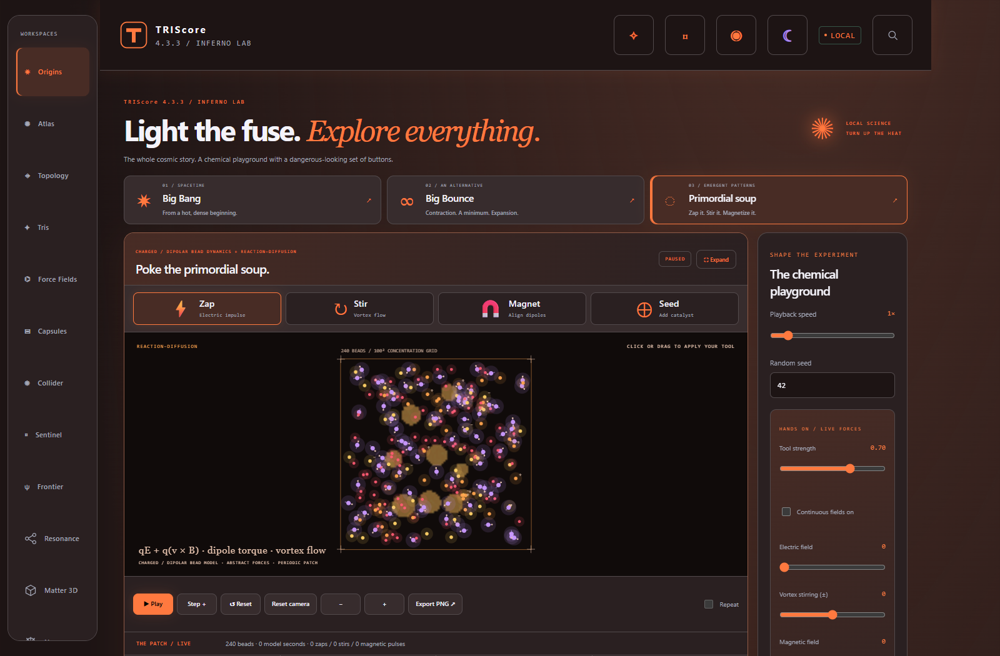

# TRIScore

A local Windows science workbench for exploring cosmic history, geometry, and hands-on particle experiments—with an Aero-style window and colors you can make your own.



## Download

**[Windows ARM64](https://github.com/dreamflexinc/TRIS/releases/download/v4.3.3/TRIScore_4.3.3_Aero_Windows_ARM64.exe)** · **[Windows x64](https://github.com/dreamflexinc/TRIS/releases/download/v4.3.3/TRIScore_4.3.3_Aero_Windows_x64.exe)**

Version **4.3.3**. Choose ARM64 for Windows on ARM, or x64 for Intel/AMD Windows. The executables are portable, self-contained, and unsigned. An installed **Microsoft Edge WebView2 Runtime** is required.

Close the earlier app before launching this version. Existing desktop profiles, saved work, and custom colors are preserved; the earlier profile remains intact. See [desktop notes](DESKTOP.md) for details.

## Explore

- **Cosmic Origins:** Big Bang epochs from hot plasma to the cosmic web, plus a speculative Big Bounce model.
- **Primordial soup:** charged and dipolar coarse-grained beads, reaction–diffusion fields, and **Zap**, **Stir**, **Magnet**, and **Seed** tools. Capture experiments and export JSON or PNG.
- **Retained workbenches:** Manifold Atlas, Chaos Topology, Force Fields, Collider, Capsules, encrypted Tris continuity, notebooks, and the original labs.
- **Your palette:** independent light/dark themes and graph colors, HEX/RGB controls, line weights and patterns, pure-black mode, and appearance backup/restore. Native Aero-style chrome follows the theme.

These are educational models with explicit assumptions. The soup uses abstract bead dynamics and concentration fields; the bounce is illustrative. Equations, units, limits, and references are documented in [ORIGINS-MODELS.md](ORIGINS-MODELS.md).

## Build

Use **Node.js 22+**:

```powershell
npm ci
npm run build
npm test
```

For Windows executables, install the .NET SDK pinned in [global.json](global.json), then build the architectures sequentially:

```powershell
.\desktop\Build-Desktop.ps1 -Runtime win-arm64 -OutputDirectory .\work\publish-arm64
.\desktop\Build-Desktop.ps1 -Runtime win-x64 -OutputDirectory .\work\publish-x64
```

The desktop build checks the entry document against `BUILD-MANIFEST.json`. See [DESKTOP.md](DESKTOP.md) for build and runtime details. Browser checks are available through `npm run test:browser`.

## Verification

The 4.3.3 release passed **92 unit checks, 10 browser checks, and 48 native checks**. ARM64 was checked natively on Windows ARM; x64 was checked under emulation on the same computer. Separate Intel/AMD hardware has not been tested. See [RELEASE-REPORT.txt](RELEASE-REPORT.txt) for the recorded results.

## License

Licensed under [GPL-3.0](LICENSE). Bundled dependency notices are in [desktop/THIRD-PARTY-NOTICES.txt](desktop/THIRD-PARTY-NOTICES.txt).
